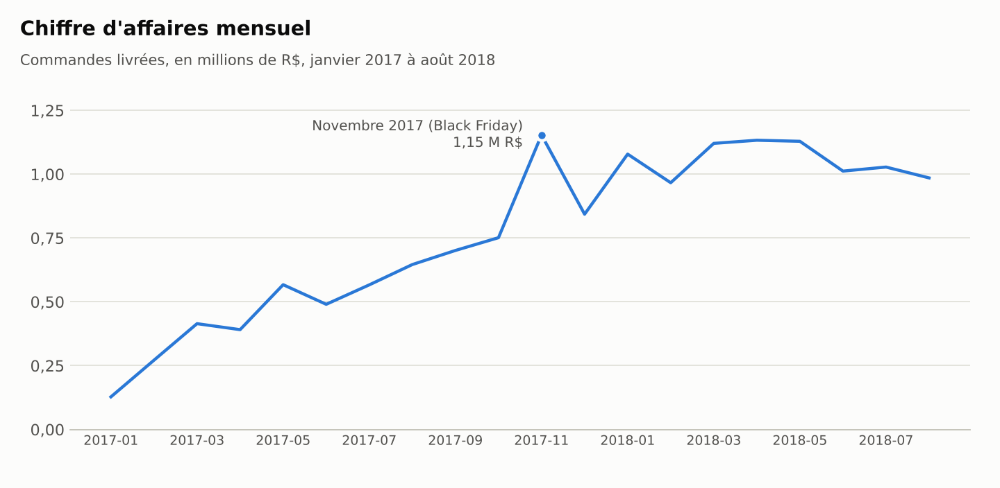
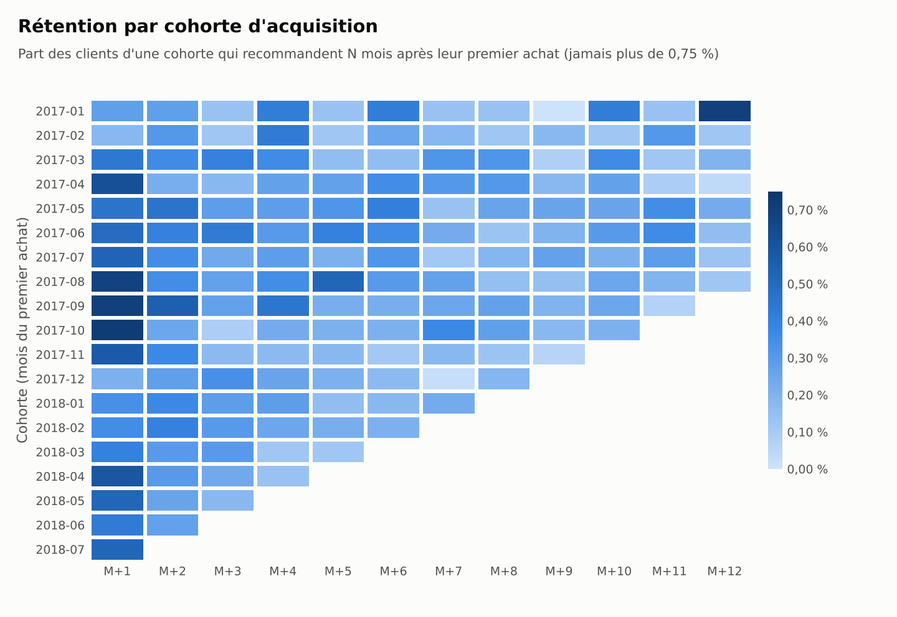
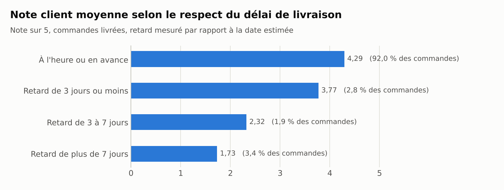

# 📊 E-Commerce SQL Analytics & Customer Retention

Analyse de la performance commerciale et de la fidélisation client de la marketplace brésilienne **Olist**, à partir de son dataset public (~100 000 commandes réelles, 2016-2018).

## 🎯 Problématique business

La croissance d'Olist repose-t-elle sur des clients qui reviennent, ou uniquement sur l'acquisition de nouveaux acheteurs ? Et quels leviers actionner en priorité ?

## 🔍 Résultats

Tous les chiffres portent sur les commandes livrées. Ils sont reproductibles avec les requêtes du dossier `sql/` et disponibles en CSV dans `results/`.

### 1. Une croissance forte en 2017, un plateau en 2018



- **15,4 M R$** de chiffre d'affaires pour **96 211 commandes** entre janvier 2017 et août 2018.
- Le CA mensuel passe de 0,13 M R$ (janvier 2017) à 1,15 M R$ en novembre 2017, pic du Black Friday avec 7 289 commandes.
- Depuis janvier 2018, il stagne entre 0,97 et 1,13 M R$ par mois : la croissance s'est arrêtée.
- Le panier moyen est stable, à **160 R$** (entre 146 et 170 R$ selon les mois).

### 2. Presque aucun client ne revient

| Commandes par client | Clients | Part |
|---|---:|---:|
| 1 | 90 557 | 97,00 % |
| 2 | 2 573 | 2,76 % |
| 3 et plus | 228 | 0,24 % |



- **97 % des clients n'ont commandé qu'une seule fois.**
- Quelle que soit la cohorte, moins de 0,75 % des clients recommandent un mois donné. Le mois qui suit le premier achat, le taux médian est de 0,49 %.
- Les clients récurrents (3 % de la base) ne pèsent que **5,6 % du chiffre d'affaires**. Leur panier moyen est même plus bas que celui des acheteurs uniques (146 R$ contre 161 R$).

### 3. Quand le réachat existe, il est rapide

| Délai entre la 1re et la 2e commande | Clients | Part |
|---|---:|---:|
| Même jour | 853 | 30,5 % |
| 1 à 30 jours | 559 | 20,0 % |
| 31 à 90 jours | 495 | 17,7 % |
| 91 à 180 jours | 409 | 14,6 % |
| 181 à 365 jours | 403 | 14,4 % |
| Plus de 365 jours | 82 | 2,9 % |

- La moitié des deuxièmes commandes arrive dans les 30 jours.
- Près d'un tiers a lieu le jour même : il s'agit plutôt d'un panier fractionné que d'une vraie fidélité. Sans ces cas, le taux de réachat réel tombe à environ 2,1 %.

### 4. Les retards de livraison détruisent la satisfaction



- 92 % des commandes arrivent à l'heure et obtiennent une note moyenne de 4,29/5.
- Au-delà de 7 jours de retard, la note tombe à **1,73/5** et 78 % des avis sont négatifs (1 ou 2 étoiles).
- En revanche, la satisfaction ne suffit pas à faire revenir : le taux de réachat est de 2,7 % après une première note de 1/5 et de 3,1 % après un 5/5.

### 5. Un chiffre d'affaires réparti sur de nombreuses catégories

Les trois premières catégories (santé-beauté, montres-cadeaux, linge de maison) représentent chacune 8 à 9 % du CA produits ; le top 10 en totalise 62 %. Détail dans `results/06_ca_par_categorie.csv`.

## 💡 Recommandations

1. **Tester une relance dans les 30 jours qui suivent le premier achat.** C'est la fenêtre où se concentre le réachat. Avec un taux de départ aussi bas, l'effet doit être mesuré par un test A/B avant tout arbitrage budgétaire entre acquisition et CRM.
2. **Fiabiliser la promesse de livraison.** Les 8 % de commandes en retard concentrent les avis négatifs. C'est le levier de satisfaction le plus net dans les données, même si son effet sur le réachat n'est pas démontré ici.
3. **Ne pas prioriser un programme VIP.** Seuls 228 clients ont commandé trois fois ou plus : la base est trop étroite pour le rentabiliser. Mieux vaut d'abord obtenir une deuxième commande.

## ⚠️ Limites

- Olist est une marketplace : le client achète à un vendeur tiers, ce qui explique en partie la faible fidélité à la plateforme.
- La fenêtre d'observation est de 20 mois. Les dernières cohortes ont eu peu de temps pour recommander.
- Les liens observés (retard et note, note et réachat) sont des corrélations, pas des preuves de causalité.
- Le CA par catégorie repose sur le prix des articles hors frais de port, le paiement n'étant pas ventilé par article.

## 🚀 Reproduire l'analyse

1. Télécharger le dataset [Brazilian E-Commerce Public Dataset by Olist](https://www.kaggle.com/datasets/olistbr/brazilian-ecommerce) et décompresser les CSV dans un dossier `data/` à la racine.
2. Lancer :

```bash
pip install -r requirements.txt
python setup_db.py      # crée la base SQLite olist_ecommerce.db
python run_query.py     # exécute les requêtes et écrit results/*.csv
python make_charts.py   # génère charts/*.png
```

`python run_query.py 03 07` n'exécute que les requêtes dont le nom commence par 03 ou 07.

## 🛠️ Stack technique

- **SQL (SQLite)** : jointures multi-tables, CTE (`WITH`), fonctions de fenêtrage (`ROW_NUMBER`, `COUNT OVER`), analyse de cohortes, manipulation de dates (`STRFTIME`, `JULIANDAY`).
- **Python** : pandas pour l'ingestion et l'export, matplotlib pour les graphiques.

## 📂 Structure du répertoire

| Fichier | Rôle |
|---|---|
| `setup_db.py` | Charge les 8 tables CSV dans SQLite et crée les index |
| `run_query.py` | Exécute les requêtes de `sql/` et exporte les résultats |
| `make_charts.py` | Génère les graphiques du README |
| `sql/01_ventes_mensuelles.sql` | Commandes, CA et panier moyen par mois |
| `sql/02_taux_reachat.sql` | Répartition des clients par nombre de commandes |
| `sql/03_cohortes_retention.sql` | Rétention mensuelle par cohorte d'acquisition |
| `sql/04_delai_reachat.sql` | Délai entre la première et la deuxième commande |
| `sql/05_valeur_client.sql` | CA par client et poids des clients récurrents |
| `sql/06_ca_par_categorie.sql` | Top 10 des catégories |
| `sql/07_livraison_satisfaction.sql` | Note client selon le retard de livraison |
| `sql/08_reachat_selon_satisfaction.sql` | Taux de réachat selon la note de la première commande |
